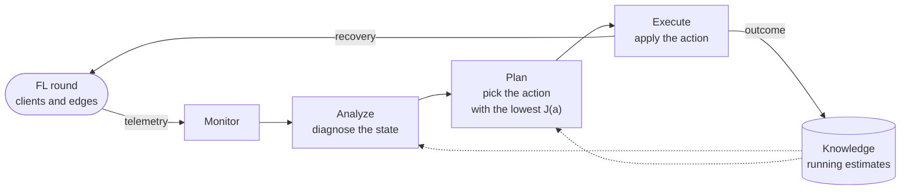
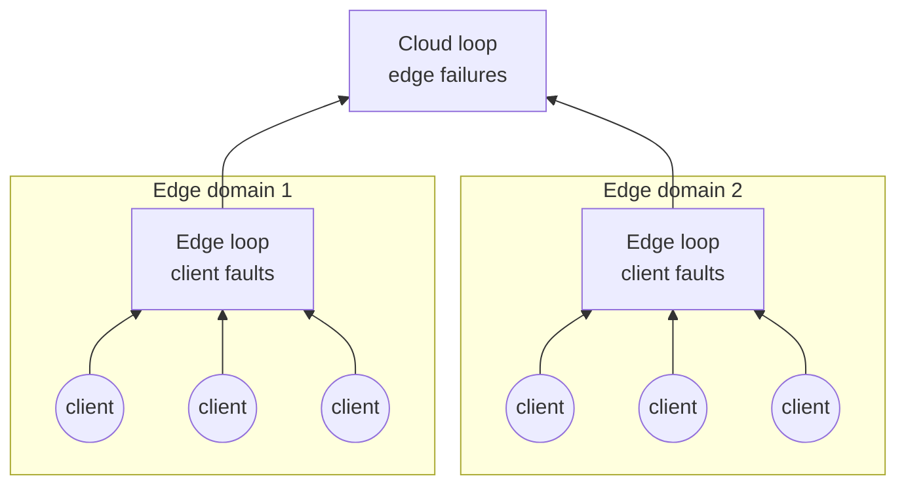

# MARE-FL

**Adaptive fault recovery for federated learning across the cloud–edge continuum**

Federated learning (FL) trains a shared model on many devices without moving their data. In practice, those devices are not reliable: some crash, some lose the connection for a moment, others answer too late, and the edge servers that collect their updates can go down as well. MARE-FL is a fault manager for this setting. Instead of answering every failure with the same fixed rule, it decides during training how to recover from each one, using a MAPE-K feedback loop and what it has learned about every client and edge.

This repository contains the implementation of MARE-FL, the simulator used to evaluate it, the experiment configurations and the scripts that rebuild every number of the evaluation.

## Why recovery needs to adapt

In a cloud–edge deployment, clients send their updates to an edge server, each edge aggregates the updates it receives, and the cloud combines the edge aggregates into the new global model. In every round, several things can go wrong:

| Fault | What happens | What can still be done |
|---|---|---|
| Straggler | The client answers after the deadline | Wait for it |
| Temporary disconnection | The client drops out, but it can be reached again in the same round | Retry |
| Crash | The client will not answer in this round | Give its work to a substitute |
| Edge outage | The updates held by that edge are lost | Wait for the edge, send its updates through another edge, or aggregate without it |

Most FL systems tie each type of fault to one fixed response: they always wait, always drop the client or always replace it. The right response, however, depends on the situation. Waiting is cheap when the client usually answers, and wasteful when it rarely does. A replacement saves the contribution, but it costs a full model download and a new local training, and the substitute can fail too. Dropping a client costs nothing at that moment, yet with non-IID data it can remove most of the evidence for a class. MARE-FL treats recovery as a decision taken at runtime, with these trade-offs in view.

## How MARE-FL works

MARE-FL follows the MAPE-K model of autonomic computing: a loop that monitors the system, analyzes what it sees, plans a response and executes it, all on top of a shared knowledge base.



- **Monitor** collects operational signals from each selected client and edge: whether it answered, how long it took, whether it missed the deadline and how long an outage lasted. MARE-FL never inspects the training data or the content of the updates.
- **Analyze** turns these signals into a small set of states: Healthy, Straggler, Disconnected or Failed for a client, and Healthy or Unavailable for an edge.
- **Plan** lists the actions that make sense for that state and chooses the one with the lowest expected cost:

  $$J(a) = w_t\,T(a) + w_c\,C_{\mathrm{comm}}(a) + w_p\,C_{\mathrm{comp}}(a) + w_f\,R(a) + w_d\,L(a)$$

  Here $T$ is the expected recovery time, $C_{\mathrm{comm}}$ the extra communication, $C_{\mathrm{comp}}$ the extra computation, $R$ the risk that the action fails and $L$ the progress lost if the update is discarded. A client can be waited for, retried, replaced or dropped. A failed edge can be waited for, bypassed by rerouting its cached updates to another edge, left out through partial aggregation, or dropped.
- **Execute** applies the chosen action and reports whether it worked.
- **Knowledge** keeps running estimates (exponentially weighted moving averages) of the reliability, latency and recovery success of every client and edge. The planner uses them to price each action, and the executor uses them to choose the substitute for a replacement: the most reliable idle client. The estimates are updated only after all the decisions of a round, so every client of the round is planned against the same information.

The weights of $J$ are set by the operator; nothing has to be trained. Since $J$ is linear, the weights work as readable thresholds. With $w_t = 1$, for example, $w_c$ says how many seconds one megabyte is worth, and $w_d$ is the longest delay worth accepting to keep one update. A larger model or a slower link makes a replacement costlier, so the planner uses it less.

### Centralized or hierarchical

The same loop can run in two places. In **MARE-Centralized**, one loop in the cloud takes every decision. In **MARE-Hierarchical**, the loops follow the structure of the federation: each edge handles the faults of its own clients, and the cloud only steps in when an edge fails.



| | MARE-Centralized | MARE-Hierarchical |
|---|---|---|
| Client faults are handled by | the cloud loop | the loop of the client's edge |
| Edge failures are handled by | the cloud loop | the cloud loop |
| A substitute is searched in | the whole federation | the edge's own domain first |
| Control latency of one decision | 0.090 s | 0.015 s |
| Main advantage | sees every client | decides faster, close to the clients |

## How it is evaluated

Everything runs on one machine: clients, edges, faults and network delays are simulated, while the model is really trained with PyTorch. This makes the experiments cheap to repeat and, above all, fair, because every strategy can face exactly the same failures.

- **Federation.** 20 clients are split across 4 edges, and 10 of them are selected in each of the 50 rounds. Every client trains a small multilayer perceptron for one local epoch, and both edges and cloud aggregate with FedAvg.
- **Data.** Fashion-MNIST and UCI-HAR (human activity recognition from smartphone sensors). The data is divided among the clients with a Dirichlet distribution over labels, from very skewed to mild.
- **Faults.** The client failure probability goes from 0 to 0.5 and the edge failure probability from 0 to 0.15. A client failure is either a temporary disconnection or a crash, stragglers appear independently, and a two-state Markov process creates bursts that raise the failure rates inside one edge domain for a few rounds.
- **Paired traces.** Client selection and fault injection use their own random generator, separate from the one used by the recovery actions. For a given seed, every strategy sees the same selected clients and the same faults, so any difference comes from the recovery policy alone. Each pair of strategies is compared over the 108 matched scenarios of each dataset with a Wilcoxon signed-rank test.
- **Baselines.**

  | Baseline | Recovery policy |
  |---|---|
  | FedAvg-Drop | Ignores every faulty client and failed edge |
  | FedAvg-Wait | Waits for stragglers and for short edge outages, retries disconnected clients and drops crashed ones |
  | Static Replacement | Replaces every faulty client with a random idle one and reroutes every failed edge |
  | Minimal Repair | Replaces a faulty client with the idle client whose label distribution is closest, information that MARE-FL does not use, and drops failed edges |

- **Metrics.** The main metric is the fraction of effective updates: the share of selected clients whose update, original or recovered, reaches their edge. The cost side is measured as traffic, time to recovery, control time and round latency, and the final accuracy checks that the extra updates do not hurt learning.

## What we found

Averages over the 108 paired scenarios of each dataset. Eff.: fraction of effective updates. Rec.: recovery success. Comm.: GB per 50-round run. Acc.: final accuracy.

| Method | Fashion-MNIST Eff. | Rec. | Comm. | Acc. | UCI-HAR Eff. | Rec. | Comm. | Acc. |
|---|---|---|---|---|---|---|---|---|
| FedAvg-Drop | 0.606 | - | 0.448 | 0.756 | 0.606 | - | 0.338 | 0.701 |
| FedAvg-Wait | 0.795 | 0.790 | 0.506 | 0.777 | 0.795 | 0.790 | 0.382 | 0.741 |
| Static Replacement | 0.821 | 0.581 | 0.628 | 0.784 | 0.821 | 0.581 | 0.474 | 0.746 |
| Minimal Repair | 0.823 | 0.551 | 0.605 | 0.775 | 0.823 | 0.550 | 0.456 | 0.743 |
| MARE-Centralized | **0.888** | 0.749 | 0.582 | **0.788** | **0.890** | 0.746 | 0.441 | 0.753 |
| MARE-Hierarchical | 0.877 | 0.722 | 0.579 | 0.786 | 0.878 | 0.717 | 0.438 | **0.757** |

- **More updates survive.** With both MARE-FL variants, almost nine out of ten selected updates reach their edge, against about eight out of ten for the replacement baselines and FedAvg-Wait, and six out of ten for FedAvg-Drop. MARE-FL wins all 108 paired scenarios against Static Replacement and Minimal Repair on both datasets, and the gap grows with the failure rate.
- **No extra traffic.** MARE-FL moves about 7% less data than Static Replacement, because a replacement is the most expensive action and the planner only pays for it when the alternatives look worse.
- **The price is time.** Every decision adds control latency, so rounds become longer as failures grow. When nothing fails, MARE-FL behaves like FedAvg-Wait and its control time is pure overhead: adaptation only pays off once failures appear.
- **Where the gain comes from.** With the default weights, the planner almost always waits for stragglers, retries disconnected clients and replaces crashed ones. A fixed rule that does the same and takes the most reliable idle client as substitute matches MARE-FL; with a random substitute, it falls about two points behind. In this setting, the gain comes from having several actions and from choosing the substitute with the knowledge base, while the cost model mostly reproduces a sensible rule. The cost model should matter more when clients are heterogeneous.
- **Edge placement is the better default.** MARE-Hierarchical keeps about 99% of the effective updates of MARE-Centralized, with a final accuracy that is statistically indistinguishable, while it needs 4.3 times less control time and its rounds are 43% shorter.

## Limitations

- The results come from a simulation. Latencies, outages and recovery outcomes are sampled from models, and control latencies are set rather than measured, so the reported times support comparisons between strategies, not wall-clock claims.
- All clients share the same failure probability and the model is small. The knowledge base therefore has little client-specific structure to learn, and communication carries little weight in the cost.
- The planner prices a replacement with the history of the failed client, not with that of the candidate.
- Only benign faults are covered. Byzantine or malicious clients are a different problem.
- The planner is reactive: it acts after a deadline is missed, not before.

## Getting started

You need Python 3.10 or newer on Linux (the scripts were tested on Ubuntu 22.04 and 24.04). A GPU is not needed.

```bash
git clone https://github.com/2023JoshuaP/MARE-FL.git
cd MARE-FL
bash scripts/setup_ubuntu.sh    # creates .venv, installs requirements.txt and runs the unit tests
source .venv/bin/activate
```

The datasets are downloaded the first time they are used and stored in `~/.cache/marefl`. Fashion-MNIST comes from torchvision and UCI-HAR from the UCI Machine Learning Repository.

To check the installation:

```bash
python -m pytest tests/
bash scripts/smoke_test.sh
```

The smoke test runs the unit tests, two short runs on the small Digits dataset, and a check that all the strategies receive exactly the same selected clients and the same injected faults. To try the whole pipeline on a reduced grid (12 runs per dataset), run `bash scripts/run_main_experiments.sh`.

## Reproducing the results

**From our raw results (a few seconds):**

```bash
python make_paper_results.py results/grid_fashion_full.csv.gz results/grid_har_full.csv.gz \
    --out results/paper --plots
```

**Running all the experiments again (several hours):**

```bash
bash scripts/run_main_experiments_parallel.sh
python make_paper_results.py results/grid_fashion_full.csv results/grid_har_full.csv \
    --out results/paper --plots
```

The full grid crosses 6 strategies, 3 seeds, 4 client failure probabilities, 3 edge failure probabilities and 3 levels of label skew on two datasets, which gives 1,296 runs of 50 rounds in total. The script uses 64 parallel processes; change `--workers` in `scripts/run_main_experiments_parallel.sh` to match your machine.

| Result | File in `results/paper/` |
|---|---|
| Main results table (effective updates, recovery success, traffic and final accuracy) | `table2.csv` |
| Paired comparisons: wins, median differences and Wilcoxon tests | `paired_tests.csv` |
| Effective updates for each failure probability | `by_failure_rate.csv`, `fig2.png` |
| Actions chosen by the planner for each type of fault | `action_mix.csv`, `state_action.csv`, `fig3.png` |

The fault traces depend only on the seed and on the failure probabilities, and training uses its own random generator. Effective updates, recovery success, traffic and latency are therefore reproduced exactly; the accuracy can change a little between machines or library versions.

A few details are useful to read the numbers correctly:

- **Control time.** Each decision adds a fixed control latency, 0.015 s at an edge and 0.090 s in the cloud. The latency of a round is its slowest event plus the control latency of all its decisions, which are processed one after another.
- **Recovery outcomes.** A retry or a replacement succeeds with a probability that depends on the reliability of the client in the knowledge base.
- **Effective updates.** `make_paper_results.py` also reports a stricter version, `effective_global`, which removes the updates that are lost later because their edge failed.
- **Recovery success.** Total successful recoveries divided by total recovery attempts. `analyze_results.py` reports the mean of the per-round ratios instead, so its value is slightly different.
- **Final accuracy.** The test accuracy of the last round of each run, averaged over the 108 scenarios of each dataset.

## Code organization

```
marefl/                   MARE-FL and the simulator
configs/                  YAML configurations (main_fashion.yaml and main_har.yaml are the main experiments)
scripts/                  setup, smoke test and experiment scripts
tests/                    unit tests
main.py                   runs one configuration
run_grid.py               runs a grid in one process
run_grid_parallel.py      runs the full grid in several processes
make_paper_results.py     builds the tables and figures of the evaluation from the grid CSV files
analyze_results.py        quick summary of one grid CSV (used by the scripts in scripts/)
plot_results.py           accuracy and latency plot of the reduced grid
results/
  grid_fashion_full.csv.gz   raw results for Fashion-MNIST (648 runs, one row per round)
  grid_har_full.csv.gz       raw results for UCI-HAR (648 runs, one row per round)
```

| Part of MARE-FL | Code |
|---|---|
| Monitor, Analyze, Plan | `marefl/mapek.py` |
| Execute | `marefl/simulator.py` (`_execute_client` and the edge loop in `run`) |
| Knowledge | `marefl/knowledge.py` |
| Fault model | `marefl/faults.py` |
| Baselines | `marefl/simulator.py` and `marefl/baselines.py` |
| Non-IID partition | `marefl/data.py` (`dirichlet_partition`) |

## Configuration

All parameters are defined in `marefl/config.py` and can be changed in the YAML files. These are the main ones:

| Parameter | Value used | Meaning |
|---|---|---|
| `num_clients`, `num_edges`, `clients_per_round` | 20, 4, 10 | size of the federation |
| `rounds` | 50 | rounds per run |
| `client_failure_prob`, `edge_failure_prob` | varied in the grid | failure probabilities |
| `disconnect_fraction` | 0.45 | share of client failures that are temporary |
| `straggler_prob` | 0.10 | probability that a client is late |
| `planner_w_time`, `_comm`, `_compute`, `_failure`, `_drop` | 1.00, 0.18, 0.35, 1.10, 1.60 | weights of the cost function $J$ |
| `knowledge_ewma` | 0.75 | weight of the previous value in the running estimates |
| `local_control_latency_s`, `cloud_control_latency_s` | 0.015, 0.090 | control latency of one decision |

## License

This project is released under the MIT License. See the [LICENSE](LICENSE) file for details.
